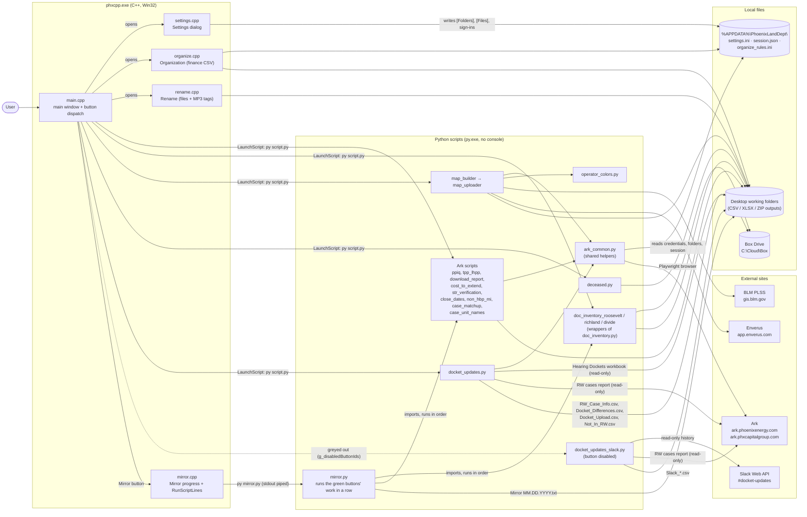
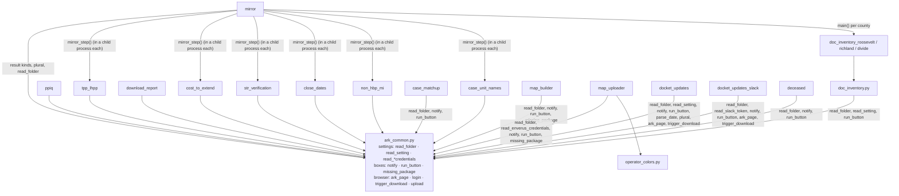
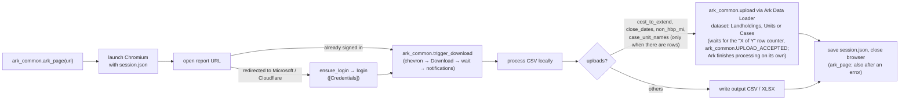
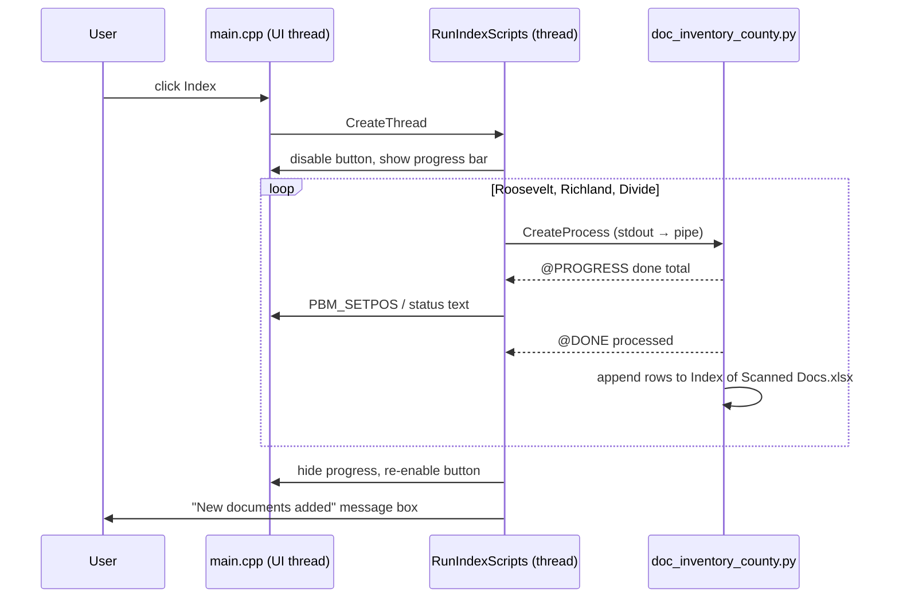
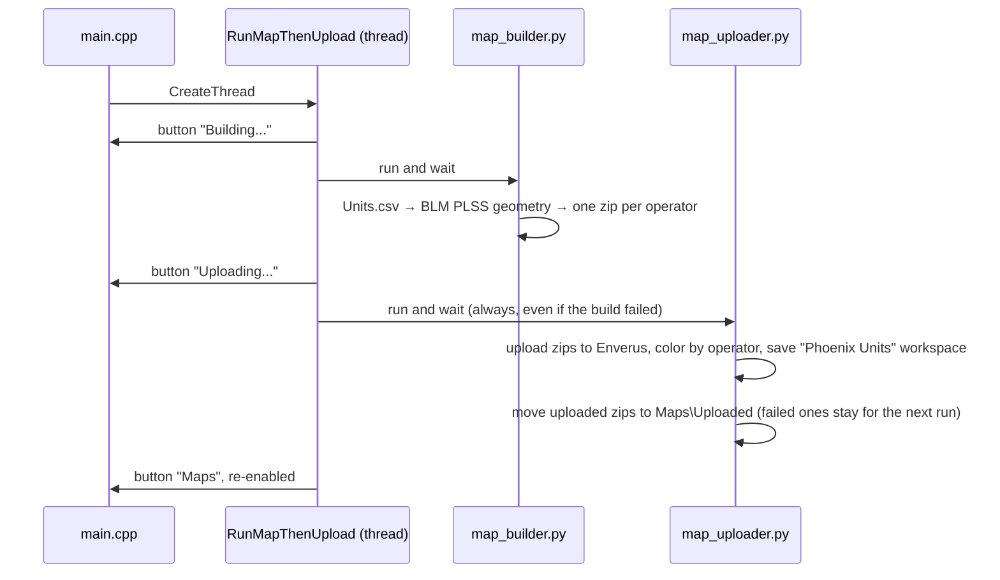
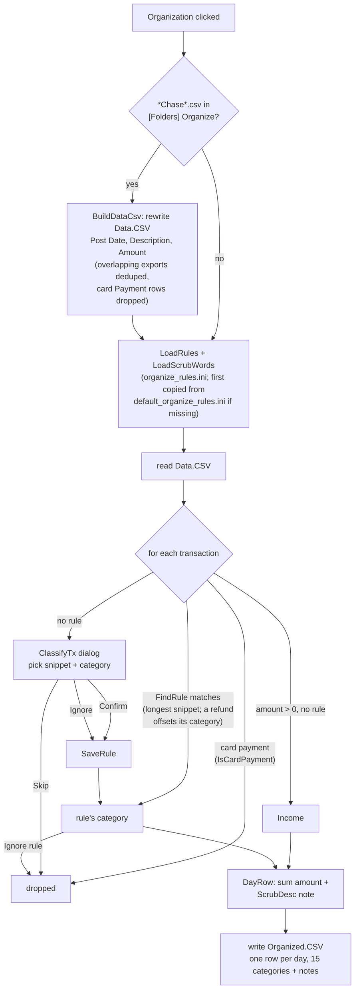
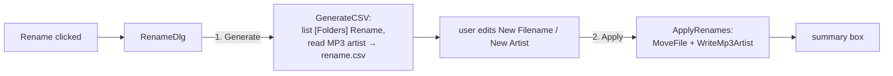
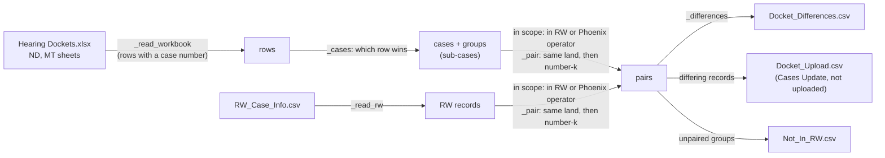
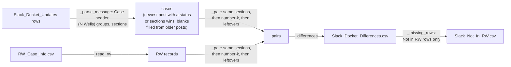
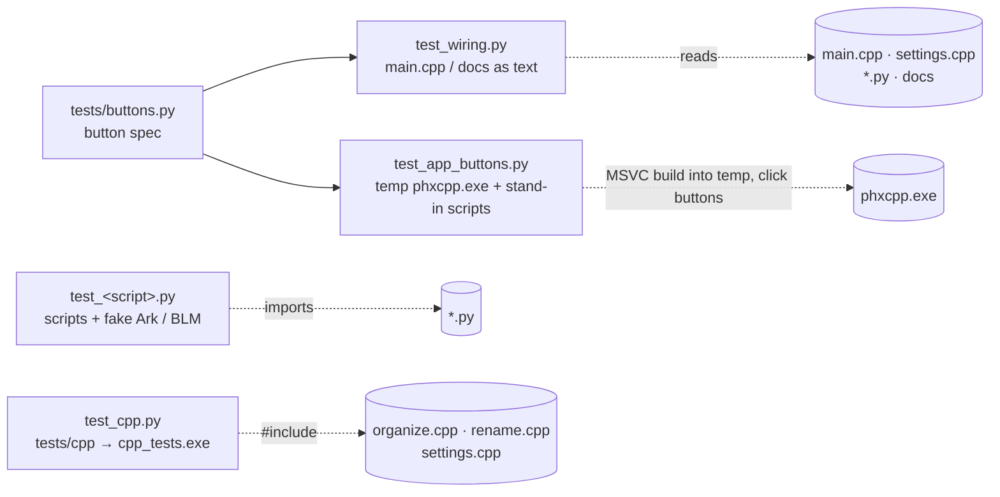

# Architecture — Phoenix Land Department Reporting

`phxcpp.exe` is a small Win32 launcher (C++) with a grid of buttons. Most buttons run a
Python script that sits next to the exe; a few open dialogs written in C++. The scripts
automate Ark (Phoenix's land system), Enverus/drillinginfo and local Box Drive folders.

Companion docs:
- [INDEX.md](INDEX.md) — every function, global and constant, by file
- [KNOWN_ISSUES.md](KNOWN_ISSUES.md) — bugs and risks found while documenting
- [TESTING.md](TESTING.md) — the regression tests: how to run them, what they cover

> Diagrams use [Mermaid](https://mermaid.js.org). They render on GitHub, and in VS Code's
> Markdown preview with the *Markdown Preview Mermaid Support* extension.

---

## 1. System overview



**How a script button works:** `WM_COMMAND` in `main.cpp` calls `LaunchScript`, which runs
`py "<exeDir>\script.py" <args>` with `CREATE_NO_WINDOW` and does not wait (Index, Maps and Mirror
run on threads instead, below). With no console, a script's only visible output is its own message
box, so every script's `__main__` goes through `ark_common.run_button`: an error writes
`<script>_error.log` in the script's folder and shows an error box naming the error and the log.
The map scripts also say which package to `pip install` if one is missing (`ark_common.missing_package`).

---

## 2. Button map

Layout is set in `LayoutControls` (main.cpp); labels and ids are in the `buttons[]`
table in `WM_CREATE`. Each button is labeled with the Desktop folder its work goes to (e.g. C2E =
`Desktop\C2E`; Mirror's archive is `Desktop\Mirror\Archive`). Each column has a header (`g_columnHeaders`): 1 **Daily**, 2 **Set Date**, 3 **As Needed**, 4 **In Progress**. **Yellow** = not implemented yet (listed in `g_unwiredButtonIds`).
**Green** = also run by Mirror (listed in `g_mirrorSteps`; see [§5](#5-mirror)).
**Greyed out** = works but is switched off (listed in `g_disabledButtonIds`; `WM_COMMAND` ignores it too). Its click
handler is still in place, so removing the id from that list reactivates it.

| Col | Button | Runs | Changes live data? |
|---|---|---|---|
| Top-left | Mirror | Yes/No confirmation, then `mirror.py` (background thread, progress bar): runs the green buttons' work in a row, then a report box + `Mirror MM.DD.YYYY.txt`. Reads **Stop** while running |  **Yes — the uploads of its steps** |
| 1 | Close Date *(green)* | `close_dates.py` (no upload when nothing closed) | **Yes — Ark Landholdings Update** |
| 1 | Case Update *(green)* | `non_hbp_mi.py` (no upload when the report is empty) | **Yes — Ark Units Update** |
| 1 | Index *(green)* | `doc_inventory_roosevelt.py` → `_richland.py` → `_divide.py`, wrappers of `doc_inventory.py` (background thread, progress bar) | Appends to `Index of Scanned Docs.xlsx` in Box (backed up per county first) |
| 1 | Cases Unit Names *(green)* | `case_unit_names.py` → `Case_Unit_Names.MM.DD.YYYY.csv` (Record Id, PHX Unit Name for each case whose Sections equal a unit's STRs and whose name is blank or different), uploaded when it has rows | **Yes — Ark Case Update** |
| 1 | STR *(green)* | `str_verification.py` → `Error_Report.csv` (Section Name mismatches) + a box with the count | No |
| 1 | TPP-LHPP *(green)* | `tpp_lhpp.py` → `PHX_Price_Paid_Export.xlsx` + message box of exported offers with a Close Date | No |
| 1 | C2E *(green)* | `cost_to_extend.py` | **Yes — Ark Landholdings Update** |
| 1 | Docket Updates | `docket_updates.py`: the ND and MT sheets of the Hearing Dockets workbook in Box compared with the Ark RW cases report → `Desktop\Docket Updates\Docket_Differences.csv`, `Docket_Upload.csv` (a Cases Update for the Data Loader, **not uploaded**) and `Not_In_RW.csv` (see *Docket Updates comparison*) | No (reads Box and Ark only) |
| 1 | Docket Updates Slack *(greyed out)* | `docket_updates_slack.py`, the Slack version of Docket Updates until 2026-10-16: Cheyanne Winn's #docket-updates messages → `Slack_Docket_Updates.csv`, their cases compared with RW → `Slack_Docket_Differences.csv`, `Slack_Not_In_RW.csv` (see *Docket Updates Slack comparison*) | No (reads Slack and Ark only) |
| 1 | Settings *(bottom-left)* | `OpenSettings` (settings.cpp): every folder, the index and Hearing Dockets workbooks and the sign-ins | settings.ini |
| 2 | PPIQ | `ppiq.py` → `Update_Inverted.csv` + a box with the issue count | No (downloads + local CSV) |
| 2 | AOI | `str_verification.py --aoi` → `AOI MM.DD.YYYY.csv` (unverifiable Areas of Interest) + a box with the count | No |
| 2 | DMD | `download_report.py` + a box saying where the reports went | No |
| 2 | Organization | `OpenOrganize` (organize.cpp; folder `[Folders] Organize`) | No |
| 3 | Unit Connect to Cases | `case_matchup.py` | No |
| 3 | Bring out your dead | `deceased.py` → `deceased_upload.csv` + a box with the row count | No (writes upload CSV only) |
| 3 | Rename | `OpenRename` (rename.cpp; folder `[Folders] Rename`) | **Renames files / rewrites MP3s** |
| 3 | Maps | `map_builder.py` then `map_uploader.py` (background thread) | **Yes — Enverus layers/workspace** |
| 4 | ELMI, DNM, HBPNW, LE, LHP, NHBPW, SIB, UNLE, SL, HBP Wells | *(yellow — TODO)* | — |

While Mirror runs, PPIQ, AOI and DMD are disabled too (`g_lockedDuringMirror`), because
their scripts share the Ark login (session.json) with Mirror's steps.

### Adding a new script button
1. `#define ID_BUTTON_X <unused id>` at the top of main.cpp.
2. Add `{ ID_BUTTON_X, TEXT("Label") }` to `buttons[]` in `WM_CREATE`.
3. Add a `MoveWindow` line for it in `LayoutControls`.
4. Add an `else if (LOWORD(wParam) == ID_BUTTON_X)` branch in `WM_COMMAND` calling `LaunchScript(hwnd, TEXT("x.py"))`.
   If the script uses the Ark login, add the id to `g_lockedDuringMirror` (test_wiring checks).
5. In the script, end with `ark_common.run_button('Label', main, <log path>)` so errors reach the user;
   add a Settings row (settings.cpp `s_settings`) for any folder it reads. Update this table and [INDEX.md](INDEX.md).
6. Add the button to `BUTTONS` in `tests/buttons.py`, write `tests/test_<script>.py`, and run `py -m pytest`
   (see [TESTING.md](TESTING.md#adding-or-changing-a-button)). The wiring tests fail until steps 1–6 are done.

---

## 3. Python module dependencies



Third-party libraries: `playwright` (all Ark scripts, map_uploader; imported only when a browser
is opened, so ark_common itself needs only the standard library), `openpyxl` (tpp_lhpp, doc_inventory,
docket_updates), `PyPDF2` (doc_inventory), `requests`, `pyshp`, `shapely` (map_builder). docket_updates_slack calls
Slack with the standard library (`urllib`); both docket scripts use `playwright` only for the RW report download.

### Typical Ark script flow

Used by ppiq, tpp_lhpp, download_report, cost_to_extend, str_verification, close_dates, non_hbp_mi and case_unit_names.



---

## 4. Background runs: Index and Maps

### Index — stdout protocol

`RunIndexScripts` runs on its own thread. `RunOneIndexScript` pipes each script's stdout
and parses two tags:

| Line | Meaning |
|---|---|
| `@PROGRESS <done> <total>` | moves the progress bar; `total = -1` → marquee (Richland) |
| `@DONE <processed>` | new documents added, shown in the final summary |

A tag can appear anywhere in a line. The scripts print a `\rProcessing: …` line with no newline
just before each tag, so the tag usually lands mid-line.

The three county scripts only pick their `County` from doc_inventory.py, which does the work. A county
stops with a readable message (shown in an "Index (<County>)" error box) if the workbook is missing, has no
tab for it, or is open in Excel; that last one is checked before the scan, so a run never fails after the
long scan. Each county backs the workbook up as `<workbook>.<County>.bak` before appending.



### Maps



---

## 5. Mirror

**Mirror** (top-left) runs the work of the green buttons one after another and ends with one
report of what each did. Clicking a green button on its own still works exactly as before.

1. `StartMirror` (mirror.cpp) refuses to start if a green button is busy (e.g. Index running on its
   own), then asks Yes/No, listing the steps and the ones that upload to Ark.
2. It disables the green buttons and the other buttons sharing the Ark login (PPIQ, AOI,
   DMD; `g_lockedDuringMirror`), relabels Mirror **Stop**, shows the progress bar
   and status label (bottom-right, where Index's are) and runs
   `py mirror.py --stop-file "%TEMP%\phx_mirror_stop_<pid>_<run>.flag"` on a thread, reading its stdout.
   mirror.py runs inside a **kill-on-close job object**, so everything it starts (step processes,
   Chromium) ends when the job is ended or the app exits.
3. `mirror.py` runs each step's `mirror_step()` in this order: Index, Close Date, Case Update,
   STR, TPP-LHPP, C2E, Cases Unit Names. Each step runs in its **own child
   process** (`mirror.py --step <n> <lo> <hi> <label>`), **quietly** (its own message boxes are off).
   The child's output passes through to mirror.cpp, and it reports back with one `@RESULT` line.
   A step that raises (or `sys.exit`s), crashes, or is still running after **20 minutes**
   (`STEP_TIMEOUT_S`; its process tree, browser included, is killed) is reported as Failed and the
   run carries on.
4. At the end it appends the report to `Mirror MM.DD.YYYY.txt` in `[Folders] MirrorArchive`
   (default `Desktop\Dailies\Archive`), prints `@FINISHED`, and shows the report in a message box.
   mirror.cpp restores the buttons **at `@FINISHED`**, so a report box left open doesn't lock the app.
   If mirror.py dies before `@FINISHED`, mirror.cpp shows "Mirror stopped before it finished".

**Stop.** Clicking Stop asks Yes/No (No is the default), then `StopMirror` creates the stop file and the
button reads "Stopping...". mirror.py checks for the file every 0.5 s: it kills the running step's
process tree (reported **Stopped**; an uploading step's line says to check the Data Loader history,
since Ark finishes an upload it already has), lists the remaining steps as **Not run**, and writes and
shows the report as usual ("stopped early" in its header). If mirror.py hasn't reached `@FINISHED`
30 s after Stop (`kMirrorStopGraceMs`), the timer ends the job and the "stopped before it finished"
box appears instead.

```mermaid
sequenceDiagram
    participant U as User
    participant C as mirror.cpp (UI + RunMirror thread)
    participant P as mirror.py
    participant S as mirror.py --step n (child, one per step)
    U->>C: click Mirror
    C->>U: Yes/No (steps, uploads)
    U->>C: Yes
    C->>P: py mirror.py --stop-file path (in a job, stdout piped)
    loop STEPS
        P-->>C: @STAGE lo hi "Step i of n: name"
        P->>S: start child (20 min limit)
        S-->>C: @STAGE / @PROGRESS lines (passed through)
        S-->>P: @RESULT kind, report line (or crash / timeout → Failed)
    end
    opt user clicks Stop, Yes
        C->>P: create stop file
        P->>S: kill process tree → Stopped; remaining steps Not run
    end
    P->>P: append report to Mirror MM.DD.YYYY.txt
    P-->>C: @FINISHED
    C->>C: hide progress, re-enable buttons
    P->>U: report message box
    C->>C: mirror.py exits: close job, delete stop file
```

### Output protocol (mirror.py → mirror.cpp)

| Line | Meaning |
|---|---|
| `@STAGE <lo> <hi> <label>` | A step (or Index county) starts: bar to `lo`%; status shows the label |
| `@PROGRESS <done> <total>` | From the Index scripts: fills the bar between `lo` and `hi`; `total = -1` shows a count |
| `@FINISHED` | The report is written; mirror.cpp restores the buttons. Anything after this is just the message box |
| `@RESULT <kind>\t<line>` | Child → mirror.py only (never reaches mirror.cpp): a step's result |

The status label also shows the time elapsed since the run started (a timer updates it every second,
so it keeps moving during long Ark waits). Labels are UTF-8.

### Report

Each step returns `(kind, line)`. The report groups them under these headings, in this order, and
leaves out empty groups:

| Kind | Meaning | Steps that can return it |
|---|---|---|
| Uploaded | Changed live data | Index (rows added to the sheet), Close Date, Case Update, C2E, Cases Unit Names |
| Needs review | Wrote a report to look at | STR (Section Name mismatches), TPP-LHPP (mismatches closing in the next 14 days, or with a Close Date it couldn't read) |
| No changes | Ran fine, nothing to do | all |
| Failed | Raised an error (the first line of it is shown), crashed, or was stopped at the time limit | all |
| Stopped | Was running when the user clicked Stop | all |
| Not run | Skipped because the user clicked Stop | all |

### Adding a step to Mirror

1. In the button's script, add `mirror_step()`: run the script's work **without message boxes**
   and return `(ark_common.UPLOADED | REVIEW | NOTHING, "one line for the report")`. Usually
   `main()` returns a count and `mirror_step()` turns it into the line. Let errors raise.
2. Add `Step('<button label>', module.mirror_step, uploads=<True if it changes Ark>)` to `STEPS`
   in mirror.py, where you want it in the order.
3. Add `{ ID_BUTTON_X, true|false }` to `g_mirrorSteps` in main.cpp, in the same position.
   The button turns green.
4. Tests: `mirror_step` cases in `tests/test_<script>.py`; update the step list in
   `test_steps_are_the_mirror_buttons_in_order` (tests/test_mirror.py). `test_wiring` checks the two
   tables agree.
5. Update the button map above, the step list in §5 and [INDEX.md](INDEX.md).

---

## 6. C++ dialogs

### Settings (settings.cpp)
A modeless popup; the main window stays disabled until it closes. One row per entry of the
`s_settings` table: every `[Folders]` key, `[Files] IndexWorkbook` and `HearingDockets`, and the Ark, Enverus and Slack
sign-ins (passwords and the token show as dots). **Change** opens the `PickPath` picker (folder, or
`.xlsx` for the workbook); **Save** takes the typed value. Either writes just that key (`SaveSetting`).
`LoadSettings` runs once at startup; Organization and Rename read their folders with `GetSetting`.

### Organization (organize.cpp)



### Rename (rename.cpp)



---

## 7. Configuration and shared state

All under `%APPDATA%\PhoenixLandDept\`.

### settings.ini

| Section / key | Written by | Read by |
|---|---|---|
| `[Folders] DataMeetingDownload` | Settings dialog | download_report (default `Desktop\DMD`) |
| `[Folders] STRVerification` | Settings dialog | str_verification (STR button; default `Desktop\STR`) |
| `[Folders] AOI` | Settings dialog | str_verification `--aoi` (AOI button; default `Desktop\AOI`) |
| `[Folders] CloseDates` | Settings dialog | close_dates (default `Desktop\Close Date`) |
| `[Folders] Maps` | Settings dialog | map_builder, map_uploader (default `Desktop\Maps`) |
| `[Folders] PPIQ` | Settings dialog | ppiq (default `Desktop\PPIQ`) |
| `[Folders] TPPLHPP` | Settings dialog | tpp_lhpp (default `Desktop\TPP-LHPP`) |
| `[Folders] CostToExtend` | Settings dialog | cost_to_extend (default `Desktop\C2E`) |
| `[Folders] CaseMatchup` | Settings dialog | case_matchup (default `Desktop\Unit Connect to Cases`) |
| `[Folders] CaseUnitNames` | Settings dialog | case_unit_names (default `Desktop\Cases Unit Names`) |
| `[Folders] NonHBPMI` | Settings dialog | non_hbp_mi (Case Update button; default `Desktop\Case Update`) |
| `[Folders] DocketUpdates` | Settings dialog | docket_updates and docket_updates_slack (default `Desktop\Docket Updates`) |
| `[Files] HearingDockets` | Settings dialog | docket_updates: the Hearing Dockets workbook (default `C:\Cloud\Box\Land\01. Permit & Hearing Tracking\02. State Permits & Hearings\ND,MT,UT,WY - Hearing Dockets.xlsx`) |
| `[Folders] Deceased` | Settings dialog | deceased (default `Desktop\Bring out your dead`) |
| `[Folders] Index` | Settings dialog | doc_inventory: the county CSVs (default `Desktop\Index`) |
| `[Files] IndexWorkbook` | Settings dialog | doc_inventory: the index workbook (default `C:\Cloud\Box\Ethan Mesecher\Index of Scanned Docs.xlsx`) |
| `[Folders] Organize` | Settings dialog | organize.cpp (default `Desktop\Organization`) |
| `[Folders] Rename` | Settings dialog | rename.cpp (default `Desktop\Rename`) |
| `[Folders] MirrorArchive` | Settings dialog | mirror (report archive; default `Desktop\Dailies\Archive`) |
| `[Credentials] username`, `[Credentials] password` | Settings dialog | every Ark script, via `ark_common.read_credentials` |
| `[EnverusCredentials] identifier`, `[EnverusCredentials] password` | Settings dialog | map_uploader, via `ark_common.read_enverus_credentials` |
| `[SlackCredentials] token` | Settings dialog (see *Slack token* below) | docket_updates_slack, via `ark_common.read_slack_token` |

When a key is missing, each script falls back to the default shown (Desktop paths are under
`C:\Users\Ethan Mesecher`; another user sets their own in Settings). Values are read as typed: a `%`
in a password is fine (`ark_common._read_ini` turns configparser interpolation off).

### Slack token

Docket Updates Slack (greyed out since 2026-10-16) reads Slack as you, with a user token from a Slack app you create once:
1. https://api.slack.com/apps → **Create New App** → *From scratch* → pick the Phoenix workspace.
2. **OAuth & Permissions** → *User Token Scopes* → add `channels:history`.
3. **Install to Workspace** (a workspace admin may need to approve it).
4. Paste the **User OAuth Token** (`xoxp-…`) into the **Slack token** row in Settings and click Save
   (it is stored as `[SlackCredentials] token` in settings.ini).
The token can read every public channel you can, so keep it out of code, docs and chat.
The channel and Cheyanne are found by Slack id (`_CHANNEL_ID`, `_USER_ID` in docket_updates_slack.py),
so renaming either doesn't break the export.

### Docket Updates comparison

docket_updates reads the **ND** and **MT** sheets of the Hearing Dockets workbook (`[Files] HearingDockets`),
downloads the RW cases report (`_REPORT_URL`, saved as `RW_Case_Info.csv`) and compares them. Nothing is uploaded:
`Docket_Upload.csv` is loaded by hand (Data Loader → Update → Cases) once it has been checked.



- **Sheets.** Only ND and MT (`_SHEETS`); UT, WY and Sheet2 are not read yet (see KNOWN_ISSUES). Columns are found by
  header name (`_WB_COLUMNS`). Rows without a case number (most 2022–2024 ND rows) are skipped.
- **Scope.** A case is compared when RW has it (the number or a `<number>-…` sub-case) or any of its rows has an
  Operator containing "Phoenix". Other cases are ignored.
- **Which row wins** (`_cases`; a case is re-listed at every hearing it is continued to):
  - groups (sub-cases): the rows of the latest hearing date that lists sections, in sheet order; rows with the same
    land are one group (the sheet lists a case once per relief, e.g. ND 32346 Authorize Drilling + AUTHORIZE WELLS),
    and RW's type may match any of their types;
  - Hearing Date: the latest; Case Type: the latest row that has one, "(Continued)" removed;
  - status, Order Number, Date Order Signed: the latest row with a recognized result, even when a later hearing
    re-lists the case (Notes says so). An Order Number on more than `_FILL_DOWN_CASES` (50) cases, such as ND's
    35278 on ~2,600 rows, is a fill-down slip and is ignored with its date;
  - no result anywhere: Docketed if the latest hearing is today or later, otherwise status isn't compared.
- **Status** (`_EXPECTED_STATUS`): GRANTED / PARTIALLY GRANTED → Ordered / Granted; DENIED → Ordered / Denied;
  DISMISSED (and the typo DIMISSED) / WITHDRAWN → Dismissed. CONTINUED, X, P&A and other text count as no result.
  Dismissed and Docketed mean a blank Order Status: an RW value there is an Order Status difference with a note to
  clear it by hand (the upload never writes a blank).
- **Type** (`_TYPE_MAP`): the sheet's types mapped to RW's; the generic ESTABLISH SPACING matches any RW spacing type
  (`_TYPE_FAMILIES`), but not the other way: RW's generic Establish Spacing against a specific type in the sheet is a
  difference, and the upload makes RW specific (intended). Unmapped types (Define Field Limits, Amendment-…, Extend
  Field…) aren't compared.
- **Sections** are compared as land (4×4 quarter-quarter grid per section). For well-location types (`_WELL_TYPES`:
  SWD, Commingling, Show Cause, Permit Protest, Recompletion Certification) the sheet gives the well's quarter-quarter
  and RW the section, so only whole sections are compared. A group with an unreadable line (lots, a field name) isn't compared.
- **Hearing Date, Date Order Signed** are compared as dates; **Order Number** as text. A field is compared only when
  the workbook has a value and the RW report has the column (missing columns are named in the finish box). An RW
  date the script can't read always differs; Notes names it.
- **Pairing** (`_pair`): same land first, then group k ↔ `<number>-k` (a lone group ↔ `<number>`), then a lone
  unpaired group takes the leftovers. An unpaired group is *Not in RW*; a leftover `<number>` / `<number>-k` is
  *Not in workbook*, and so is every RW case whose number isn't on the sheets (Utah `YYYY-NNN` numbers skipped).
- **Docket_Upload.csv**: one row per differing RW record, Record Id plus every compared column the report has; the
  workbook value where it differs and RW's own value elsewhere, so a blank never overwrites Ark data. Every readable
  date is written MM/DD/YYYY. A record whose only difference is an Order Status to blank gets no row.
- **Not_In_RW.csv**: the workbook side of every *Not in RW* group in RW's column names (sub-cases numbered
  `<number>-k`), ready to become an Insert.

### Docket Updates Slack comparison

The disabled Slack version (docket_updates_slack.py) reads every board order case out of the messages and compares it
with the RW cases report (`_REPORT_URL`, saved as `Slack_RW_Case_Info.csv`):



- **Cases.** Posts that share any case number are one case (`196-2025` and `196-2025 / 32-2025 FED`). It's taken
  from the newest post with a status or sections, so a later reply like "Case 32384 was corrected" doesn't replace
  it. Whatever that post leaves blank (status, type, applicant, sections) comes from the newest older post that has
  it, and Notes says which ("Sections from the 09/09/2026 post"); a status written but not recognized isn't blank.
  The other posts go to Notes and every number posted is looked up in RW. A header without a status takes it from
  the next non-blank line only.
- **Pairing.** A case's RW candidates are its number(s) and every `<number>-…` sub-case. Each `(N Wells)` group
  (or the whole case when there are none) pairs with every candidate whose sections are the same land, then with
  sub-case `<number>-k` by position (a single group: `<number>` itself), then a lone unpaired group takes all
  leftovers. A group with no pair is *Not in RW*; a leftover `<number>` or `<number>-k` is *Not in message*
  (Roman-numeral field-rules sub-cases such as `32665-V-1` are not listed).
- **Sections** are compared as land: each section is a 4×4 grid of quarter-quarters, so Slack's
  `11-156N-91W-W2` equals RW's `NW-11-156N-91W, SW-11-156N-91W`. Missing from RW / Extra in RW list the gap
  in RW's style. Skipped when the message lists no sections.
- **Status**: `_EXPECTED_STATUS` (GRANTED, PARTIALLY GRANTED, DENIED → Case Status Ordered; DISMISSED →
  Dismissed). Order Status (Granted / Denied; blank when dismissed) is compared only if the report has that column.
- **Type**: `_TYPE_RULES`. Pooling → Pooling; Pooling and Spacing (either order: Spacing & Pooling,
  Pooling/Spacing) → Pooling or any spacing type; its
  AMENDMENT / RECONSIDERATION / EXCEPTION → any spacing type or Increased Density; Spacing → spacing types;
  Authorize Wells, Additional Wells, Capacity → Increased Density; Authorize Drilling → Permit to Drill;
  Revoke → Show Cause; anything else (Redefine Field Limits, Montana AMENDMENT – CONTESTED…) is not compared.
- **Applicant** is shown side by side but never compared (Slack uses short names like `CONTINENTAL`).
- **Slack_Not_In_RW.csv** lists the Slack side of every *Not in RW* row (one per missing well group): Case Number, State
  as its postal code (`_STATE_CODES`; ND, MT; blank if no state heading), Applicant, Case Type as written, Case
  Status / Order Status in RW's terms from `_EXPECTED_STATUS` (GRANTED → Ordered / Granted, DENIED → Ordered /
  Denied, DISMISSED → Dismissed / blank; both blank when Slack has no result), and Sections as written in Slack.

### Other shared files

| File | Owner | Purpose |
|---|---|---|
| `session.json` | Ark scripts, via `ark_common.ark_page` | Playwright login cookies; skips re-login. Saved after every run, also a failed one. |
| `organize_rules.ini` | organize.cpp | `[Rules]` snippet → category, `[ScrubWords]`, `[Meta] ColumnSchema` |
| `default_organize_rules.ini` (repo, next to the exe) | organize.cpp (read only) | Committed copy of the rules; becomes `organize_rules.ini` on a machine that has none. Refresh it by copying `organize_rules.ini` back into the repo. |
| `<Maps>\operator_colors.json` | operator_colors.py | stable fill color per operator |

### Hardcoded paths (no setting)

| Feature | Path |
|---|---|
| Index | Box image folders under `C:\Cloud\Box\Land\Title Folder\Document Images\...` (`doc_inventory._BOX_IMAGES`, per county in `ROOSEVELT` / `RICHLAND` / `DIVIDE`) |

---

## 8. Build

`build_and_run.bat` compiles every `*.cpp` (including mirror.cpp) with MSVC (VS at `...\Visual Studio\18\Community`),
embeds the manifest, and launches the exe with `explorer` (Device Guard blocks `start`).
It does not commit or push. Python scripts are not compiled; they must sit next to the exe.

---

## 9. Tests

`py -m pytest` (or the VS Code Testing panel) runs the regression tests in `tests/`, offline, in
about 30 seconds. Details are in [TESTING.md](TESTING.md).



`tests/conftest.py` blocks the browser, network (connections and DNS) and message boxes, and points
`ark_common` at a fake settings.ini, so no test reaches Ark, Enverus, BLM or Slack or touches real files. The C++ builds go to temp
folders, never the repo.
