# Architecture — Phoenix Land Department Reporting

`phxcpp.exe` is a small Win32 launcher (C++) with a grid of buttons. Most buttons run a
Python script that sits next to the exe; a few open dialogs written in C++. The scripts
automate Ark (Phoenix's land system), Enverus/drillinginfo and local Box Drive folders.

Companion docs:
- [INDEX.md](INDEX.md) — every function, global and constant, by file
- [KNOWN_ISSUES.md](KNOWN_ISSUES.md) — bugs and risks found while documenting
- [TESTING.md](TESTING.md) — the regression tests: how to run them, what they cover

> Diagrams use [Mermaid](https://mermaid.js.org). They render on GitHub, and in VS Code's
> Markdown preview with the *Markdown Preview Mermaid Support* extension.

---

## 1. System overview

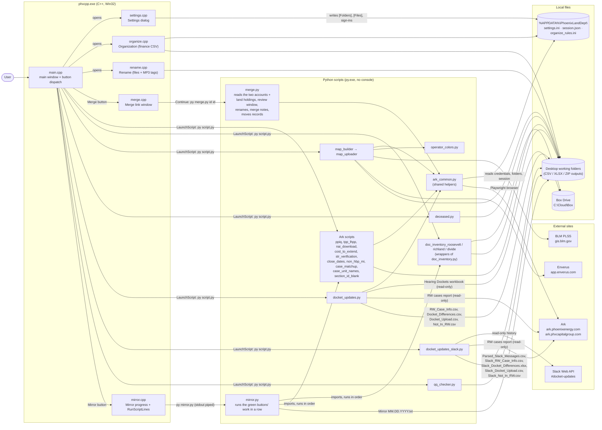

**How a script button works:** `WM_COMMAND` in `main.cpp` calls `LaunchScript`, which runs
`py "<exeDir>\script.py" <args>` with `CREATE_NO_WINDOW` and does not wait (Index, Maps and Mirror
run on threads instead, below). With no console, a script's only visible output is its own message
box, so every script's `__main__` goes through `ark_common.run_button`: an error writes
`<script>_error.log` in the script's folder and shows an error box naming the error and the log.
**Large Ark downloads need a Yes:** before `trigger_download` asks Ark for an export it reads the report
page's **Total Record Count** (`ark_common.record_count`). At `ark_common.LARGE_DOWNLOAD_ROWS` (10,000) or more,
or if the count can't be read, a topmost Yes/No box ("Large Ark download", No as the default) names the count
and report link, and the script waits. Yes downloads as usual. No raises `DownloadCancelled`, so nothing is
requested or downloaded, and `run_button` shows "<title> stopped. Large download cancelled: …" (no error log).
In Mirror the step waits the same way (its time limit paused, the progress label saying so), and a No fails
only that step. Every Ark report goes through `trigger_download`, so this covers every button. The map scripts also say which package to `pip install` if one is missing (`ark_common.missing_package`).

---

## 2. Button map

Layout is set in `LayoutControls` (main.cpp); labels and ids are in the `buttons[]`
table in `WM_CREATE`. Each button is labeled with the Desktop folder its work goes to (e.g. C2E =
`Desktop\C2E`; Mirror's archive is `Desktop\Mirror\Archive`). Each column has a header (`g_columnHeaders`): 1 **Daily**, 2 **Set Date**, 3 **As Needed**, 4 **In Progress**. **Yellow** = not implemented yet (listed in `g_unwiredButtonIds`).
**Green** = also run by Mirror (listed in `g_mirrorSteps`; see [§5](#5-mirror)).
**Hidden** = works but is switched off: created hidden and disabled (listed in `g_hiddenButtonIds`; `WM_COMMAND`
ignores it too). Its click handler and its `LayoutControls` line (last in its column) are still in place, so removing
the id from that list brings it back.

| Col | Button | Runs | Changes live data? |
|---|---|---|---|
| Top-left | Mirror | Yes/No confirmation, then `mirror.py` (background thread, progress bar): runs the green buttons' work in a row, then a report box + `Mirror MM.DD.YYYY.txt`. Reads **Stop** while running |  **Yes — the uploads of its steps** |
| 1 | Close Date *(green)* | `close_dates.py` (no upload when nothing closed) | **Yes — Ark Landholdings Update** |
| 1 | Case Update *(green)* | `non_hbp_mi.py` (no upload when the report is empty) | **Yes — Ark Units Update** |
| 1 | Index *(green)* | `doc_inventory_roosevelt.py` → `_richland.py` → `_divide.py`, wrappers of `doc_inventory.py` (background thread, progress bar) | Appends to `Index of Scanned Docs.xlsx` in Box (backed up per county first) |
| 1 | Cases Unit Names *(green)* | `case_unit_names.py` → `Case_Unit_Names.MM.DD.YYYY.csv` (Record Id, PHX Unit Name for each case whose Sections equal a unit's STRs and whose name is blank or different), uploaded when it has rows | **Yes — Ark Case Update** |
| 1 | STR *(green)* | `str_verification.py` → `Error_Report.csv` (Section Name mismatches) + a box with the count | No |
| 1 | AOI *(green)* | `str_verification.py --aoi` → `AOI MM.DD.YYYY.csv` (rows whose section isn't one their Area of Interest name lists, or whose name can't be read) + a box with the count. Also Mirror's last step, whose line ends the report: how many rows the error report has and to review it | No |
| 1 | TPP-LHPP *(green)* | `tpp_lhpp.py` → `PHX_Price_Paid_Export.xlsx` + message box of exported offers with a Close Date | No |
| 1 | C2E *(green)* | `cost_to_extend.py` | **Yes — Ark Landholdings Update** |
| 1 | SIB *(green)* | `section_id_blank.py`: downloads Landholdings Section Id Blank EM and Section ID Getting (sections created in the last week) to `[Folders] SIB`, merges the sections into `Section_ID_Index.csv` (every section; a name that comes with a new Id gets it; a name twice in one download stops the run) and deletes that download, gives each landholding with a blank Section Id the indexed Id of its Section Name → `Section_Id_Upload.MM.DD.YYYY.csv` (Id, Section Name, Section Id), uploaded when it has rows, + a box with the counts. Names with no section in Ark are left alone. `--seed` rebuilds a missing index | **Yes — Ark Landholdings Update** |
| 1 | Docket Updates Sheet | `docket_updates.py`: the ND and MT sheets of the Hearing Dockets workbook in Box compared with the Ark RW cases report → `Desktop\Docket Updates\Docket_Differences.csv`, `Docket_Upload.csv` (a Cases Update for the Data Loader, **not uploaded**) and `Not_In_RW.csv` (see *Docket Updates Sheet comparison*) | No (reads Box and Ark only) |
| 1 | Docket Updates Slack *(green)* | `docket_updates_slack.py`, the Slack version of Docket Updates Sheet, and Mirror's step before AOI: Cheyanne Winn's #docket-updates messages from the last 7 days → `Parsed_Slack_Messages.csv`, their cases compared with RW → `Slack_Docket_Differences.xlsx` (differing records, cells highlighted), `Slack_Docket_Upload.csv` (Cases Update, **not uploaded**), `Slack_Not_In_RW.csv` (see *Docket Updates Slack comparison*) | No (reads Slack and Ark only) |
| 1 | Settings *(bottom-left)* | `OpenSettings` (settings.cpp): every folder, the index and Hearing Dockets workbooks and the sign-ins | settings.ini |
| 2 | PPIQ | `ppiq.py`: 4 landholding / queue reports (saved under fixed names, columns checked) → `Update_Inverted.csv` (one row per issue: ID, Price Paid, LHT Value, Type, Account Name, LH Name, Issue, Status) + a box with the issue count (or "close it" if one of its files is open in Excel, checked before downloading) | No (downloads + local CSV) |
| 2 | NAI | `nai_download.py` (Newly Acquired Interest) + a box saying where the reports went | No |
| 2 | Organization | `OpenOrganize` (organize.cpp; folder `[Folders] Organize`) | No |
| 3 | Unit Connect to Cases | `case_matchup.py` | No |
| 3 | Bring out your dead | `deceased.py` → `deceased_upload.csv` + a box with the row count | No (writes upload CSV only) |
| 3 | Rename | `OpenRename` (rename.cpp; folder `[Folders] Rename`) | **Renames files / rewrites MP3s** |
| 3 | Maps | `map_builder.py` then `map_uploader.py` (background thread) | **Yes — Enverus layers/workspace** |
| 3 | Merge | `AskMergeAccounts` (merge.cpp): a window with two boxes for links to the Ark accounts to merge (either order; a bare record id works too). **Continue** checks them (each an `/accounts?recordId=` link, two different accounts; otherwise a red line says what's wrong and the window stays open), then runs `merge.py <id> <id>`: opens both accounts and each of their land holdings in Ark and shows a **review window** with the accounts side by side: name, link, Created Date, Account Disposition, mailing address, confirmed phone and email, Quick Reference counts (Documents, Contacts, Offers, Title Requests, Tasks, Calls & Texts, Land Holdings), Account Notes / Call Notes, and each land holding's Legal Entity, Section Name, Signers and Title Information. **Keep Account 1 / 2** picks the survivor; after a Yes/No box listing the changes, the other account is renamed "<name> (merge)", the kept one "<name> (keep)", the kept account's blank Confirmed Phone Number / Confirmed Email Addresses (and its mailing address, if wholly blank) are filled from the merge account's, a dated note block (the merge account's differing mailing address / phone / email not copied that way, and its Account Notes) goes above the kept account's Account Notes and one with its Call Notes above the kept account's Call Notes, and the merge account's contacts, offers, title requests and calls & texts get the kept account as their Account (any that won't move are listed in the closing box), and its documents are copied to the kept account by way of `[Folders] Merges` (default `Desktop\Merges`; each saved with an extension). Before the Yes, a **land holdings window** lists every land holding of both accounts, where each one's Legal Entity and signers are picked from what the land holdings have or typed in; on Yes the merge account's land holdings move to the kept account and every changed one is saved. Tasks aren't moved. If nothing is left on the merge account (land holdings checked in its Land Holdings drawer, since Ark's count can lag), both accounts open in the browser for review and the closing box asks Yes/No whether to **delete the merge account**; once it's deleted the kept account is renamed back without "(keep)". Errors go to `%APPDATA%\PhoenixLandDept\merge_error.log` | **Yes — renames both accounts, edits the kept one's notes and fills its blank phone / email / address, moves records and copies documents between them, and deletes the merge account** (after a Yes each) |
| 4 | ELMI, HBPNW, LE, LHP, NHBPW, UNLE, SL, HBP Wells | *(yellow — TODO)* | — |
| 4 | QQ *(bottom)* | `qq_checker.py`: reads `QQ_Checker.csv` (saved by hand in `[Folders] QQ`) and checks each row's Tract Description and Quarter Section against its 16 quarter-quarter NMA columns (nonzero = has a value) → `QQ_Mismatches.MM.DD.YYYY.csv` (failing rows with Mismatch = Tract / Quarter Section / Both / Unreadable and a Note naming the problem) + a box with the counts | No (local CSV only) |

While Mirror runs, PPIQ, NAI, Docket Updates Sheet and Merge are disabled too (`g_lockedDuringMirror`), because
their scripts share the Ark login (session.json) with Mirror's steps.

### Adding a new script button
1. `#define ID_BUTTON_X <unused id>` at the top of main.cpp.
2. Add `{ ID_BUTTON_X, TEXT("Label") }` to `buttons[]` in `WM_CREATE`.
3. Add a `MoveWindow` line for it in `LayoutControls`.
4. Add an `else if (LOWORD(wParam) == ID_BUTTON_X)` branch in `WM_COMMAND` calling `LaunchScript(hwnd, TEXT("x.py"))`.
   If the script uses the Ark login, add the id to `g_lockedDuringMirror` (test_wiring checks).
5. In the script, end with `ark_common.run_button('Label', main, <log path>)` so errors reach the user;
   add a Settings row (settings.cpp `s_settings`) for any folder it reads. Update this table and [INDEX.md](INDEX.md).
6. Add the button to `BUTTONS` in `tests/buttons.py`, write `tests/test_<script>.py`, and run `py -m pytest`
   (see [TESTING.md](TESTING.md#adding-or-changing-a-button)). The wiring tests fail until steps 1–6 are done.

---

## 3. Python module dependencies

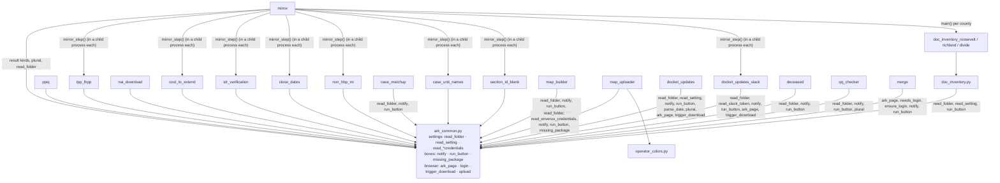

Third-party libraries: `playwright` (all Ark scripts, map_uploader; imported only when a browser
is opened, so ark_common itself needs only the standard library), `openpyxl` (tpp_lhpp, doc_inventory,
docket_updates, docket_updates_slack), `PyPDF2` (doc_inventory), `requests`, `pyshp`, `shapely` (map_builder). docket_updates_slack calls
Slack with the standard library (`urllib`); both docket scripts use `playwright` only for the RW report download.

### Typical Ark script flow

Used by ppiq, tpp_lhpp, nai_download, cost_to_extend, str_verification, close_dates, non_hbp_mi, case_unit_names and section_id_blank.

```mermaid
flowchart LR
    A["ark_common.ark_page(url)"] --> B["launch Chromium<br/>with session.json"]
    B --> C[open report URL]
    C -->|redirected to Microsoft / Cloudflare| D["ensure_login → login<br/>([Credentials])"]
    C -->|already signed in| E
    D --> E["ark_common.trigger_download<br/>(Total Record Count ≥ 10,000 or unreadable → Yes/No box first;<br/>No → DownloadCancelled, nothing requested;<br/>note files listed → chevron → Download → wait →<br/>notifications; waits for the new file and takes that one)"]
    E --> E2["ark_common.check_columns<br/>(str_verification, cost_to_extend, non_hbp_mi,<br/>case_unit_names, section_id_blank: wrong report → error)"]
    E2 --> F[process CSV locally]
    F --> G{uploads?}
    G -->|"cost_to_extend, close_dates, non_hbp_mi,<br/>case_unit_names, section_id_blank (only when there are rows)"| H["ark_common.upload via Ark Data Loader<br/>dataset: Landholdings, Units or Cases<br/>(waits for the &quot;X of Y&quot; row counter, ark_common.UPLOAD_ACCEPTED;<br/>Ark finishes processing on its own)"]
    G -->|others| I[write output CSV / XLSX]
    H --> J["save session.json, close browser<br/>(ark_page; also after an error)"]
    I --> J
```

---

## 4. Background runs: Index and Maps

### Index — stdout protocol

`RunIndexScripts` runs on its own thread. `RunOneIndexScript` pipes each script's stdout
and parses two tags:

| Line | Meaning |
|---|---|
| `@PROGRESS <done> <total>` | moves the progress bar; `total = -1` → marquee (Richland) |
| `@DONE <processed>` | new documents added, shown in the final summary |

A tag can appear anywhere in a line. The scripts print a `\rProcessing: …` line with no newline
just before each tag, so the tag usually lands mid-line.

The three county scripts only pick their `County` from doc_inventory.py, which does the work. A county
stops with a readable message (shown in an "Index (<County>)" error box) if the workbook is missing, has no
tab for it, or is open in Excel; that last one is checked before the scan, so a run never fails after the
long scan. Each county backs the workbook up as `<workbook>.<County>.bak` before appending.

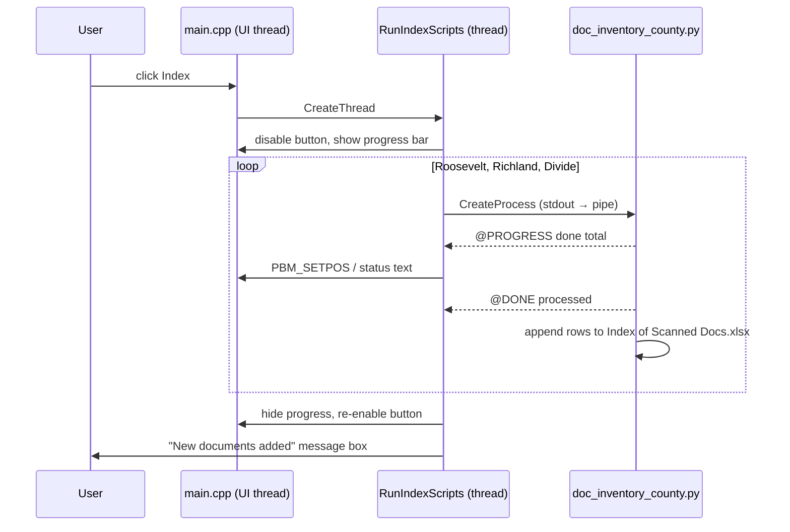

### Maps

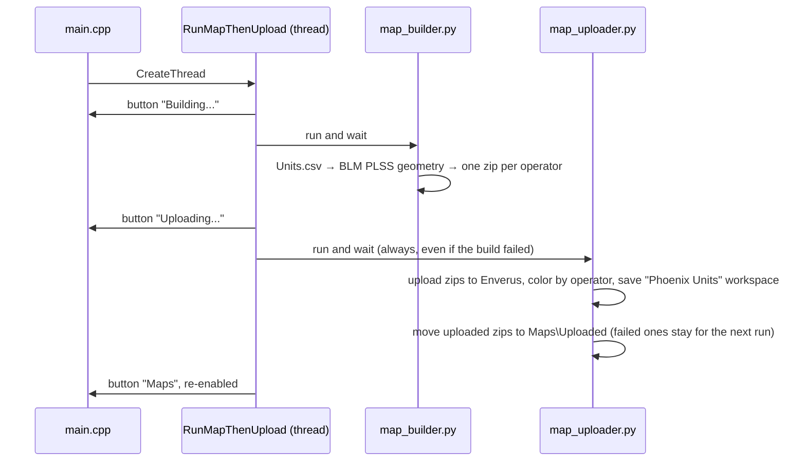

---

## 5. Mirror

**Mirror** (top-left) runs the work of the green buttons one after another and ends with one
report of what each did. Clicking a green button on its own still works exactly as before.

1. `StartMirror` (mirror.cpp) refuses to start if a green button is busy (e.g. Index running on its
   own), then asks Yes/No, listing the steps and the ones that upload to Ark.
2. It disables the green buttons and the other buttons sharing the Ark login (PPIQ,
   NAI, Docket Updates Sheet, Merge; `g_lockedDuringMirror`), relabels Mirror **Stop**, shows the progress bar
   and status label (bottom-right, where Index's are) and runs
   `py mirror.py --stop-file "%TEMP%\phx_mirror_stop_<pid>_<run>.flag"` on a thread, reading its stdout.
   mirror.py runs inside a **kill-on-close job object**, so everything it starts (step processes,
   Chromium) ends when the job is ended or the app exits.
3. `mirror.py` runs each step's `mirror_step()` in this order: Index, Close Date, Case Update,
   STR, TPP-LHPP, C2E, Cases Unit Names, SIB, Docket Updates Slack, AOI (`aoi_mirror_step`). Each step runs in its **own child
   process** (`mirror.py --step <n> <lo> <hi> <label>`), **quietly** (its own message boxes are off).
   The child's output passes through to mirror.cpp, and it reports back with one `@RESULT` line.
   A step that raises (or `sys.exit`s), crashes, or is still running after **20 minutes**
   (`STEP_TIMEOUT_S`; its process tree, browser included, is killed) is reported as Failed and the
   run carries on. A step that needs a large Ark report shows its Yes/No box even though it is quiet: the
   child prints `@WAITING` / `@RESUMED` around the box, and mirror.py pauses the 20 minutes meanwhile
   and adds ": waiting for your answer (large download)" to the progress label. A No fails that step with
   "Large download cancelled: <count> records, <report URL>".
4. The report groups the steps by result (Uploaded, Needs review, No changes, Failed, Stopped, Not run).
   A step with `report_last=True` (AOI) is left out of the groups and gets the report's last line instead,
   e.g. `AOI: 2 rows in the error report: review AOI 11.10.2026.csv` or `AOI: No rows in the error report (...)`
   (`AOI: Failed: ...` if it failed).
   At the end it appends the report to `Mirror MM.DD.YYYY.txt` in `[Folders] MirrorArchive`
   (default `Desktop\Dailies\Archive`), prints `@FINISHED`, and shows the report in a task dialog whose web links
   (e.g. a cancelled large download's report, URLs in errors) and archive path can be clicked (a plain message box if it can't open).
   mirror.cpp restores the buttons **at `@FINISHED`**, so a report box left open doesn't lock the app.
   If mirror.py dies before `@FINISHED`, mirror.cpp shows "Mirror stopped before it finished".

**Stop.** Clicking Stop asks Yes/No (No is the default), then `StopMirror` creates the stop file and the
button reads "Stopping...". mirror.py checks for the file every 0.5 s: it kills the running step's
process tree (reported **Stopped**; an uploading step's line says to check the Data Loader history,
since Ark finishes an upload it already has), lists the remaining steps as **Not run**, and writes and
shows the report as usual ("stopped early" in its header). If mirror.py hasn't reached `@FINISHED`
30 s after Stop (`kMirrorStopGraceMs`), the timer ends the job and the "stopped before it finished"
box appears instead.

```mermaid
sequenceDiagram
    participant U as User
    participant C as mirror.cpp (UI + RunMirror thread)
    participant P as mirror.py
    participant S as mirror.py --step n (child, one per step)
    U->>C: click Mirror
    C->>U: Yes/No (steps, uploads)
    U->>C: Yes
    C->>P: py mirror.py --stop-file path (in a job, stdout piped)
    loop STEPS
        P-->>C: @STAGE lo hi "Step i of n: name"
        P->>S: start child (20 min limit)
        S-->>C: @STAGE / @PROGRESS lines (passed through)
        opt report of 10,000+ records (or count unreadable)
            S-->>P: @WAITING (time limit paused)
            P-->>C: @STAGE lo hi "…: waiting for your answer (large download)"
            S->>U: Yes/No box (No → step Failed, nothing downloaded)
            S-->>P: @RESUMED (time limit restarts)
        end
        S-->>P: @RESULT kind, report line (or crash / timeout → Failed)
    end
    opt user clicks Stop, Yes
        C->>P: create stop file
        P->>S: kill process tree → Stopped; remaining steps Not run
    end
    P->>P: append report to Mirror MM.DD.YYYY.txt
    P-->>C: @FINISHED
    C->>C: hide progress, re-enable buttons
    P->>U: report message box
    C->>C: mirror.py exits: close job, delete stop file
```

### Output protocol (mirror.py → mirror.cpp)

| Line | Meaning |
|---|---|
| `@STAGE <lo> <hi> <label>` | A step (or Index county) starts: bar to `lo`%; status shows the label |
| `@PROGRESS <done> <total>` | From the Index scripts: fills the bar between `lo` and `hi`; `total = -1` shows a count |
| `@FINISHED` | The report is written; mirror.cpp restores the buttons. Anything after this is just the message box |
| `@RESULT <kind>\t<line>` | Child → mirror.py only (never reaches mirror.cpp): a step's result |
| `@WAITING` / `@RESUMED` | Child → mirror.py only (`ark_common.confirm_download`): a large-download Yes/No box opened / was answered. mirror.py pauses the step's time limit between them and re-sends `@STAGE` with the waiting label |

The status label also shows the time elapsed since the run started (a timer updates it every second,
so it keeps moving during long Ark waits). Labels are UTF-8.

### Report

Each step returns `(kind, line)`. The report groups them under these headings, in this order, and
leaves out empty groups:

| Kind | Meaning | Steps that can return it |
|---|---|---|
| Uploaded | Changed live data | Index (rows added to the sheet), Close Date, Case Update, C2E, Cases Unit Names, SIB |
| Needs review | Wrote a report to look at | STR (Section Name mismatches), TPP-LHPP (mismatches closing in the next 14 days, or with a Close Date it couldn't read; No changes instead when `PHX_Price_Paid_Export.xlsx` has exactly the rows of the last one), Docket Updates Slack (an RW record differs or a case isn't in RW; nothing is uploaded) |
| No changes | Ran fine, nothing to do | all |
| Failed | Raised an error (the first line of it is shown), crashed, was stopped at the time limit, or the user said No to a large download | all |
| Stopped | Was running when the user clicked Stop | all |
| Not run | Skipped because the user clicked Stop | all |

A step whose large Ark report (10,000+ records, `ark_common.LARGE_DOWNLOAD_ROWS`) the user said No to is
Failed with "Large download cancelled: 12,345 records, <report URL>"; one the user said Yes to runs as usual.

### Adding a step to Mirror

1. In the button's script, add `mirror_step()`: run the script's work **without message boxes**
   and return `(ark_common.UPLOADED | REVIEW | NOTHING, "one line for the report")`. Usually
   `main()` returns a count and `mirror_step()` turns it into the line. Let errors raise.
2. Add `Step('<button label>', module.mirror_step, uploads=<True if it changes Ark>)` to `STEPS`
   in mirror.py, where you want it in the order (add `report_last=True` to put its line at the end of the report, like AOI).
3. Add `{ ID_BUTTON_X, true|false }` to `g_mirrorSteps` in main.cpp, in the same position.
   The button turns green.
4. Tests: `mirror_step` cases in `tests/test_<script>.py`; update the step list in
   `test_steps_are_the_mirror_buttons_in_order` (tests/test_mirror.py). `test_wiring` checks the two
   tables agree.
5. Update the button map above, the step list in §5 and [INDEX.md](INDEX.md).

---

## 6. C++ dialogs

### Settings (settings.cpp)
A modeless popup; the main window stays disabled until it closes. One row per entry of the
`s_settings` table: every `[Folders]` key, `[Files] IndexWorkbook` and `HearingDockets`, and the Ark, Enverus and Slack
sign-ins (passwords and the token show as dots). **Change** opens the `PickPath` picker (folder, or
`.xlsx` for the workbook); **Save** takes the typed value. Either writes just that key (`SaveSetting`).
`LoadSettings` runs once at startup; Organization and Rename read their folders with `GetSetting`.
Each row reads only its own key. The pre-rename `DataMeetingDownload` key (now `NewlyAcquiredInterest`) is ignored by both `LoadSettings` and `ark_common.read_folder`, because it points at the old DMD folder.

### Organization (organize.cpp)

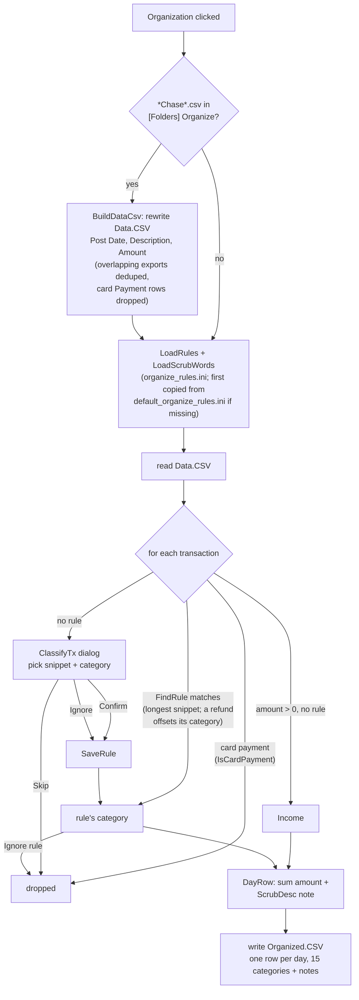

### Merge (merge.cpp)
`AskMergeAccounts` shows the **Merge Accounts** window modally (class `MergeDlg`; the main window is disabled
while it's open). It has two link boxes, a red error line, **Continue** (also Enter) and **Cancel** (also Esc).
`CheckMergeLinks` reads each box with `ParseAccountLink`: an Ark account link (`…/accounts?recordId=<24 hex
digits>`, any Ark domain, other query parts allowed) or the bare record id. Valid, different accounts close the
window and main.cpp launches `py merge.py <id> <id>` (lowercase, in the order typed); anything else leaves the
window open with the reason (empty box, not an account link, damaged id, two links in one box, the same account twice).

```mermaid
flowchart LR
    A[Merge clicked] --> B["AskMergeAccounts<br/>(MergeDlg window)"]
    B -->|Cancel / close| X[nothing runs]
    B -->|"Continue: CheckMergeLinks"| C{both links OK<br/>and different?}
    C -->|no| B
    C -->|yes| D["LaunchScript<br/>py merge.py id id"]
    D --> E["ark_page: open each account,<br/>name from the title<br/>(&quot;Account - &lt;name&gt;&quot;)"]
    E -->|"&quot;Account Not Found&quot; or<br/>no name in 30 s"| F[error box]
    E --> R["_read_account: details, counts, notes,<br/>land holding links<br/>(read until two reads 1 s apart agree)"]
    R -->|"page never filled in 30 s"| F
    R --> H["_read_holding, each land holding:<br/>Legal Entity, Section Name,<br/>Title Information, signers"]
    H -->|"&quot;Land Holding Not Found&quot;<br/>or 30 s"| F
    H --> G["review window (_show_review):<br/>accounts side by side"]
    G -->|"Cancel / close"| Z[nothing changed]
    G -->|"Keep Account N"| K["note_blocks: date, RM,<br/>differing mailing / phone / email / parent,<br/>merge account's Account / Call Notes"]
    K --> L["land holdings window (_show_holdings),<br/>if either has land holdings:<br/>Legal Entity + signers for each"]
    L -->|"Cancel / close"| Z
    L -->|"Continue: holding_plans"| Q{"Yes/No box<br/>(_confirm_text)"}
    Q -->|No| Z
    Q -->|Yes| M["apply_merge (new ark_page):<br/>Edit Account → name &quot;(merge)&quot; → Save,<br/>wait for update-sb, reload + check"]
    M --> N["kept account: name &quot;(keep)&quot;, blank phone /<br/>email / address from the merge account,<br/>blocks above its Account / Call Notes → Save,<br/>wait, reload + check"]
    N --> P["move_records: each contact, offer,<br/>title request, call &amp; text of the merge account:<br/>Edit → Account = kept account → Save, wait;<br/>list read again until none are left"]
    P -->|"a record that won't move:<br/>noted, the rest go on"| P
    P --> LH["update_holdings: each planned land holding:<br/>Edit → Account = kept (merge account's),<br/>Legal Entity, signer boxes Ark has → Save, wait, reload + check"]
    LH -->|"one that fails:<br/>noted, the rest go on"| LH
    LH --> D["move_documents: download each document<br/>to [Folders] Merges (name with an extension),<br/>upload them to the kept account, check its list"]
    D --> B2{"blockers? (records, land holdings<br/>as the drawer lists them,<br/>documents not copied, problems)"}
    B2 -->|yes| O["warning box: what needs a look,<br/>why it wasn't deleted"]
    B2 -->|no| W["both accounts open in the browser;<br/>Yes/No: delete the merge account now?"]
    W -->|No| Z2[merge account left in Ark]
    W -->|Yes| X["delete_account (new ark_page): recheck,<br/>Delete → confirm Delete, wait for Ark,<br/>check Account Not Found in another tab"]
    X --> U["untag_kept (another tab): kept account<br/>renamed without &quot;(keep)&quot;, reload + check"]
    U --> Y["box: Deleted and renamed<br/>(warning if the rename failed)"]
    M & N & X -->|"no answer in 30 s, an error,<br/>or the change not shown"| F
```

What merge.py reads (`_READ_JS` on every page; `_counts`, `_fields`, `_holding_links`, `_signers`). Every value is
shown as its text, "blank" when Ark shows "-", or "not on this page" when the page has no such item or field:

| Item | Page | Where on it |
|---|---|---|
| Created Date | account | *System Information* section (`DETAILS`) |
| Account Disposition, Mailing Street / City / State / Zip Code, Confirmed Phone Number, Confirmed Email Addresses | account | *Details* section (`DETAILS`) |
| Documents, Contacts, Offers, Title Requests, Tasks, Calls & Texts, Land Holdings (`CHECKED`) | account | the "(N)" count next to each in the **Quick Reference** bar; "none" for 0. Accounts of other kinds have no Offers, Title Requests or Land Holdings there |
| Account Notes, Call Notes (`NOTES`) | account | the *Notes* field of the Account Notes section, the *Call Notes* field of the Call Notes section |
| the account's land holdings | account | the `/land-holdings?recordId=` links in the *Land Holdings* panel (each read once). Fewer links than the count: the window says how many weren't read |
| Legal Entity, Section Name, Title Information (`HOLDING_FIELDS`) | land holding | *Details*, *Location Info*, *Title Info* sections |
| Signers | land holding | *Signer Information*: Signer 1–9, Last Name for Signer 1–2, Capacity for Signer 1–3 (all Ark has); signers with nothing filled are left out |

Ark draws each section twice (two layouts) and gives the Quick Reference id to its expanded tables too; only
"(N)" counts and the first copy of each field are taken. A value is the text of the element after the field's
label, so linked values (Section Name, emails) read like plain ones.

The review window (`_review_window`, tkinter) is a scrolling grid: a column per account, rows from `review_rows`
(including the Parent Account, `_parent`: a "Parent Account" field, else the first line of Ark's "Parent - <name>"
Quick Reference entry), then each account's land holdings under it (`_holding_lines`). The account links and land
holding names open in the browser. The browser closes (session saved) before the window opens. **Cancel** (or
closing it) ends the run with nothing changed; **Keep Account N** picks the survivor. An account whose Quick
Reference counts more land holdings than its page links has its Land Holdings side drawer read for the rest.

The **land holdings window** (`_holdings_window`, only when either account has land holdings) lists every land
holding of both accounts under its account (the merge account's marked as moving to the kept one), each with its
Section Name, Title Information and what it has now, and:
- **Legal Entity**: a box holding its current one; its list offers every Legal Entity the land holdings have
  (`holding_options`), or type your own.
- **Signers**: a row of Signer / Last Name / Capacity boxes per signer (`_SignerRows`; Capacity lists the
  capacities seen; Ark has Last Name only for Signer 1–2 and Capacity only for Signer 1–3, so those boxes are
  greyed out further down), **Copy signers from** (another land holding's signers, or "No signers") and **Add signer**
  (up to 9).
- **Set every land holding to** (top): a Legal Entity and a signer list, put into every land holding by **Apply to all**.

**Continue** passes what's in the boxes on (`holding_choices` form; `holding_plans` keeps what changes);
**Cancel** or closing it ends the run with nothing changed.

**The merge step** (after a Yes in the box, which lists both renames, the exact note blocks, what will move and
each land holding's changes; No is the default):

1. The merge account: in its **Edit Account** window (the page's Edit button), the Account Name becomes
   `"<name> (merge)"` (`tagged_name`; a `(keep)` / `(merge)` already there is replaced). Save.
2. The kept account: Account Name `"<name> (keep)"`; on the *Details* tab its blank Confirmed Phone Number /
   Confirmed Email Addresses get the merge account's, and if every part of its mailing address is blank, the
   merge account's address parts (`blank_fills`, `_DETAIL_BOX`; a box no longer blank stops the merge before this
   save); on the window's *Account Notes* tab the Notes box becomes the note block, a blank line, then the notes it
   had (`combined_notes`); the same on the *Call Notes* tab with the Call Notes block. Save; the reload must show
   the name, notes and filled fields.
3. The merge account's records (`move_records`, `MOVED`): for Contacts, Offers, Title Requests and Calls & Texts in
   turn, its Quick Reference entry opens a side drawer listing every one (`_related_links`); each record's own page
   is opened (never the drawer's row buttons, which include Delete) and in its edit window the **Account** lookup
   (`_ACCOUNT_BOX`) is changed: x on the merge account, the kept account's new name typed key by key (that's what
   the `(keep)` tag is for: it makes the name unique to search for), the one exact match picked, Save
   (`_move_record`). A record that can't be moved (its Account isn't the merge account, the search doesn't find
   exactly one account, Ark refuses the save, ...) is noted and the others still move, and each is tried once.
   The drawer is scrolled to its bottom between reads until it lists as many as its count (`_listed`, `_SCROLL_JS`:
   Ark loads a long list as it's scrolled), and read again after each pass, since each record moved leaves it;
   records counted but never listed are noted. The notes appear in the closing box under "Needs a look (not
   done)"; what's still on the merge account is counted once, after the documents step, and listed as why it
   wasn't deleted. A Quick Reference entry is clicked by its exact label (`_quick_index`: the entry counted, not
   an expanded table or other entry whose text merely contains it).
4. Land holdings (`update_holdings`, from `holding_plans`): every land holding of the merge account, and every one
   of the kept account whose Legal Entity or signers the land holdings window changed (case and spacing aside),
   is opened and, in its edit window, the Account lookup must first show its account's current name (so the
   window has loaded); a merge account land holding gets the kept account (`_pick_account`, as for records); the
   **Legal Entity** box (`_HOLDING_BOX`, on the *Details* tab) and the signer boxes Ark has (Signer 1–9, Last Name
   for 1–2, Capacity for 1–3: `_SIGNER_BOX_LIMITS`; on the *Signer Information* tab, found by the first text
   containing its name; boxes past the last signer emptied) are filled (a signer part with no box stops that land
   holding before it's opened); Save; then it's
   reloaded and must show the new Legal Entity and signers. One that fails is noted and the rest go on.
5. The merge account's documents (`move_documents`): its Documents drawer (scrolled the same way) lists them; each
   row's download button (never its other buttons, which include Delete) saves it to `[Folders] Merges` (default
   `Desktop\Merges`) as `_merge_download.part`, then it's renamed (`_file_name`): the name Ark lists it under, with
   `< > : " / \ | ? *` replaced by `_`, plus an extension when that name has none it knows (`_KNOWN_EXTENSIONS`):
   Ark's download name's, else what the file holds (`_sniff_extension`: PDF, PNG, JPG, GIF, TIF, RTF; a zip's
   folders tell .docx / .xlsx / .pptx / .zip; an old Office file's streams .doc / .xls / .msg). A document whose
   type can't be told isn't copied (noted). Then they're all uploaded through the kept account's Documents drawer
   (**Add**, the file picker, **Confirm and Upload** once each shows "Ready to Upload"), and each one Ark then
   lists on the kept account (with or without its extension) is deleted from the folder. The merge account keeps
   its copies.
6. **Deleting the merge account**, only if nothing blocks it (`apply_merge`'s `blockers`: records or land holdings
   still on it (`delete_blockers`; when Ark still counts land holdings, its Land Holdings drawer is read instead,
   `_with_listed_holdings`, since that count can lag for a while after a move), documents not all copied, or any
   problem noted). Otherwise the closing box is a warning saying why. With nothing blocking, both accounts open in
   the default browser for review, and the closing box asks Yes/No (No is the default) whether to delete it now.
   Yes: `delete_account` reopens it, checks it still has the `(merge)` name and nothing left to move, clicks
   **Delete** (top right) and **Delete** in Ark's confirmation box, waits for Ark's answer naming the account
   (any `api-ark` POST / PUT / PATCH / DELETE call with its record id), and opens the link in another tab
   (reloaded while it still shows the account, up to 30 s) to check Ark shows "Account Not Found". The page
   itself stays put: if that answer came from another call naming the account, the delete may still be on its way,
   and leaving the page would cancel it. Then `untag_kept` renames the kept account back to its name without
   `(keep)` (`untagged_name`), in another tab, and checks it after a reload. A last box says it was deleted and
   renamed (a warning with the link, if the rename failed). Answering No, or anything blocking the delete, leaves
   the `(keep)` on. Tasks aren't moved, so a deleted account's tasks go with it.

The Account Notes block (`merge_note`; nothing is added if it would be empty):

```
11/06/2026 RM - Notes from merge:
Mailing Address: 1 Main St, Billings, MT 59101      (only if different from the kept account's)
Phone: (406) 555-0100                                (only numbers the kept account doesn't have)
Email: someone@example.com                           (only addresses the kept account doesn't have)
Parent Account: Smith Holdings                       (only if different from the kept account's)
"
<the merge account's Account Notes>
"
```

An address, phone or email copied into the kept account's blank fields (`blank_fills`) isn't listed in the block.

The Call Notes block (`merge_call_note`) is the same first line and the merge account's Call Notes in quotes, without
the address / phone / email lines.

Ark closes the Edit Account window *before* it sends the save (`update-sb`), and reloading the page then cancels
it, so `_save` waits for Ark's answer for that record before anything else (for the records moved too). It also waits until the window's
Account Name box shows the account's name before reading the notes, so notes are never read from a window that
hasn't loaded. After each save `_check_saved` reloads the account and checks the new name (and notes). If a step
fails, the merge stops there with an error box. The merge account may already be renamed by then; running Merge
again is safe for the names (the tags are replaced, not doubled), but copies the documents to the kept account again.

### Rename (rename.cpp)

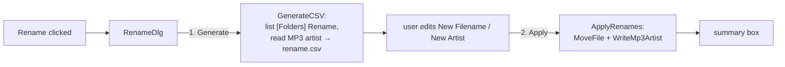

---

## 7. Configuration and shared state

All under `%APPDATA%\PhoenixLandDept\`.

### settings.ini

| Section / key | Written by | Read by |
|---|---|---|
| `[Folders] NewlyAcquiredInterest` | Settings dialog | nai_download (NAI button; default `Desktop\NAI`). Named `DataMeetingDownload` before 2026-10-28; that old key is ignored (it pointed at `Desktop\DMD`) |
| `[Folders] STRVerification` | Settings dialog | str_verification (STR button; default `Desktop\STR`) |
| `[Folders] AOI` | Settings dialog | str_verification `--aoi` (AOI button; default `Desktop\AOI`) |
| `[Folders] CloseDates` | Settings dialog | close_dates (default `Desktop\Close Date`) |
| `[Folders] Maps` | Settings dialog | map_builder, map_uploader (default `Desktop\Maps`) |
| `[Folders] PPIQ` | Settings dialog | ppiq (default `Desktop\PPIQ`) |
| `[Folders] TPPLHPP` | Settings dialog | tpp_lhpp (default `Desktop\TPP-LHPP`) |
| `[Folders] CostToExtend` | Settings dialog | cost_to_extend (default `Desktop\C2E`) |
| `[Folders] CaseMatchup` | Settings dialog | case_matchup (default `Desktop\Unit Connect to Cases`) |
| `[Folders] CaseUnitNames` | Settings dialog | case_unit_names (default `Desktop\Cases Unit Names`) |
| `[Folders] SIB` | Settings dialog | section_id_blank (SIB button; default `Desktop\SIB`) |
| `[Folders] QQ` | Settings dialog | qq_checker (QQ button; default `Desktop\QQ`): holds `QQ_Checker.csv` and the output |
| `[Folders] Merges` | Settings dialog | merge (Merge button; default `Desktop\Merges`): the merge account's documents between download and upload; emptied of each once Ark lists it on the kept account |
| `[Folders] NonHBPMI` | Settings dialog | non_hbp_mi (Case Update button; default `Desktop\Case Update`) |
| `[Folders] DocketUpdates` | Settings dialog | docket_updates and docket_updates_slack (default `Desktop\Docket Updates`) |
| `[Files] HearingDockets` | Settings dialog | docket_updates: the Hearing Dockets workbook (default `C:\Cloud\Box\Land\01. Permit & Hearing Tracking\02. State Permits & Hearings\ND,MT,UT,WY - Hearing Dockets.xlsx`) |
| `[Folders] Deceased` | Settings dialog | deceased (default `Desktop\Bring out your dead`) |
| `[Folders] Index` | Settings dialog | doc_inventory: the county CSVs (default `Desktop\Index`) |
| `[Files] IndexWorkbook` | Settings dialog | doc_inventory: the index workbook (default `C:\Cloud\Box\Ethan Mesecher\Index of Scanned Docs.xlsx`) |
| `[Folders] Organize` | Settings dialog | organize.cpp (default `Desktop\Organization`) |
| `[Folders] Rename` | Settings dialog | rename.cpp (default `Desktop\Rename`) |
| `[Folders] MirrorArchive` | Settings dialog | mirror (report archive; default `Desktop\Dailies\Archive`) |
| `[Credentials] username`, `[Credentials] password` | Settings dialog | every Ark script, via `ark_common.read_credentials` |
| `[EnverusCredentials] identifier`, `[EnverusCredentials] password` | Settings dialog | map_uploader, via `ark_common.read_enverus_credentials` |
| `[SlackCredentials] token` | Settings dialog (see *Slack token* below) | docket_updates_slack, via `ark_common.read_slack_token` |

When a key is missing, each script falls back to the default shown (Desktop paths are under
`C:\Users\Ethan Mesecher`; another user sets their own in Settings). Values are read as typed: a `%`
in a password is fine (`ark_common._read_ini` turns configparser interpolation off).

### Slack token

Docket Updates Slack (hidden 2026-10-21 to 2026-10-26, shown again since) reads Slack as you, with a user token from a Slack app you create once:
1. https://api.slack.com/apps → **Create New App** → *From scratch* → pick the Phoenix workspace.
2. **OAuth & Permissions** → *User Token Scopes* → add `channels:history`.
3. **Install to Workspace** (a workspace admin may need to approve it).
4. Paste the **User OAuth Token** (`xoxp-…`) into the **Slack token** row in Settings and click Save
   (it is stored as `[SlackCredentials] token` in settings.ini).
The token can read every public channel you can, so keep it out of code, docs and chat.
The channel and Cheyanne are found by Slack id (`_CHANNEL_ID`, `_USER_ID` in docket_updates_slack.py),
so renaming either doesn't break the export.

### Docket Updates Sheet comparison

docket_updates (the Docket Updates Sheet button) reads the **ND** and **MT** sheets of the Hearing Dockets workbook (`[Files] HearingDockets`),
downloads the RW cases report (`_REPORT_URL`, saved as `RW_Case_Info.csv`) and compares them. Nothing is uploaded:
`Docket_Upload.csv` is loaded by hand (Data Loader → Update → Cases) once it has been checked.

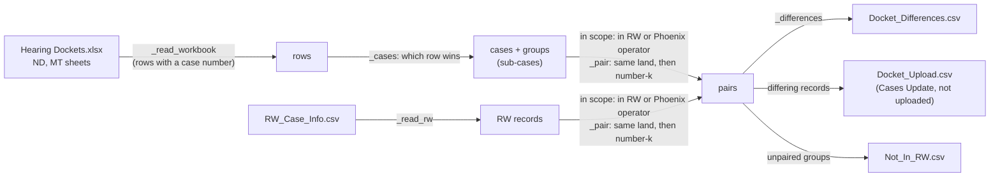

- **Sheets.** Only ND and MT (`_SHEETS`); UT, WY and Sheet2 are not read yet (see KNOWN_ISSUES). Columns are found by
  header name (`_WB_COLUMNS`). Rows without a case number (most 2022–2024 ND rows) are skipped.
- **Scope.** A case is compared when RW has it (the number or a `<number>-…` sub-case) or any of its rows has an
  Operator containing "Phoenix". Other cases are ignored.
- **Which row wins** (`_cases`; a case is re-listed at every hearing it is continued to):
  - groups (sub-cases): the rows of the latest hearing date that lists sections, in sheet order; rows with the same
    land are one group (the sheet lists a case once per relief, e.g. ND 32346 Authorize Drilling + AUTHORIZE WELLS),
    and RW's type may match any of their types;
  - Hearing Date: the latest; Case Type: the latest row that has one, "(Continued)" removed;
  - status, Order Number, Date Order Signed: the latest row with a recognized result, even when a later hearing
    re-lists the case (Notes says so). An Order Number on more than `_FILL_DOWN_CASES` (50) cases, such as ND's
    35278 on ~2,600 rows, is a fill-down slip and is ignored with its date;
  - no result anywhere: Docketed if the latest hearing is today or later, otherwise status isn't compared.
- **Status** (`_EXPECTED_STATUS`): GRANTED / PARTIALLY GRANTED → Ordered / Granted; DENIED → Ordered / Denied;
  DISMISSED (and the typo DIMISSED) / WITHDRAWN → Dismissed. CONTINUED, X, P&A and other text count as no result.
  Dismissed and Docketed mean a blank Order Status: an RW value there is an Order Status difference with a note to
  clear it by hand (the upload never writes a blank).
- **Type** (`_TYPE_MAP`): the sheet's types mapped to RW's; the generic ESTABLISH SPACING matches any RW spacing type
  (`_TYPE_FAMILIES`), but not the other way: RW's generic Establish Spacing against a specific type in the sheet is a
  difference, and the upload makes RW specific (intended). Unmapped types (Define Field Limits, Amendment-…, Extend
  Field…) aren't compared.
- **Sections** are compared as land (4×4 quarter-quarter grid per section). For well-location types (`_WELL_TYPES`:
  SWD, Commingling, Show Cause, Permit Protest, Recompletion Certification) the sheet gives the well's quarter-quarter
  and RW the section, so only whole sections are compared. A group with an unreadable line (lots, a field name) isn't compared.
- **Hearing Date, Date Order Signed** are compared as dates; **Order Number** as text. A field is compared only when
  the workbook has a value and the RW report has the column (missing columns are named in the finish box). An RW
  date the script can't read always differs; Notes names it.
- **Pairing** (`_pair`): same land first, then group k ↔ `<number>-k` (a lone group ↔ `<number>`), then a lone
  unpaired group takes the leftovers. An unpaired group is *Not in RW*; a leftover `<number>` / `<number>-k` is
  *Not in workbook*, and so is every RW case whose number isn't on the sheets (Utah `YYYY-NNN` numbers skipped).
- **Docket_Upload.csv**: one row per differing RW record, Record Id plus every compared column the report has; the
  workbook value where it differs and RW's own value elsewhere, so a blank never overwrites Ark data. Every readable
  date is written MM/DD/YYYY. A record whose only difference is an Order Status to blank gets no row.
- **Not_In_RW.csv**: the workbook side of every *Not in RW* group in RW's column names (sub-cases numbered
  `<number>-k`), ready to become an Insert.

### Docket Updates Slack comparison

The Slack version (docket_updates_slack.py) reads every board order case out of the messages and compares it
with the RW cases report (`_REPORT_URL`, saved as `Slack_RW_Case_Info.csv`). It reads only the `Case …` header
lines and the `(N Wells)` lines below them: sections, state headings and remarks are skipped, and sections aren't compared.

- **In Mirror** (since 2026-10-30): the last step, `mirror_step()`. It runs quietly: no token, a Slack error or a
  file open in Excel fail the step instead of showing a box. Any failure, in Mirror or from the button, warns that
  the comparison files may be from an earlier run and the upload file shouldn't be loaded (`RunFailed`,
  `_STALE_NOTE`; Mirror's Failed line starts with `_STALE_SHORT`). Needs review when an RW record differs or a case isn't in
  RW (the line names the files), otherwise No changes. The upload file is still only written, never uploaded.
- **Window** (`_DAYS`, since 2026-10-30): only messages sent in the last 7 days are downloaded (Slack's `oldest`
  on `conversations.history`) and compared. Only threads of posts in the window are opened for her replies. A case
  last posted before the window isn't checked, and blanks are filled only from posts in the window.

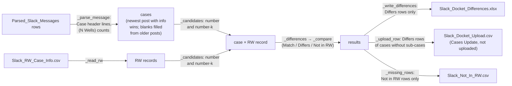

- **Cases.** Posts that share any case number are one case (`196-2025` and `196-2025 / 32-2025 FED`). It's taken
  from the newest post with a status, type, applicant or well count, so a later reply like "Case 32384 was corrected"
  doesn't replace it. Whatever that post leaves blank (status, type, applicant, well count) comes from the newest
  older post that has it, and Notes says which ("Status from the 09/09/2026 post"); a status written but not
  recognized isn't blank. The other posts go to Notes and every number posted is looked up in RW. A header without
  a status takes it from the next non-blank line only.
- **Well count** (`_WELLS_RE`): the sum of the case's `(N Wells)` lines (`(4 Wells)` + `(5 Wells)-(CHEETAH UNIT)` = 9;
  both blocks when a case is listed twice in one message), blank when it has none. It is compared with RW's
  Number of Wells column (`_RW_WELLS`, found ignoring case) when the report has it. Slack's count is for the whole
  case, so it is compared with the **total** of the RW records the case is compared with (one record: that
  record's value; a blank or unreadable one counts 0). When the total differs, every record of the case differs
  on Well Count and, with several records, Notes gives the total. A case with no `(N Wells)` line isn't compared.
- **Which RW records** (`_candidates`): for each of the case's numbers, the number itself and its plain
  sub-cases `<number>-1`, `<number>-2`, …; the case gets one row per record, in number order. Roman-numeral
  field-rules sub-cases such as `32665-V-1` are used only when RW has none of those. No record at all is *Not in RW*.
- **Status**: `_EXPECTED_STATUS` (GRANTED, PARTIALLY GRANTED, DENIED → Case Status Ordered; DISMISSED →
  Dismissed). Order Status (Granted / Denied; blank when dismissed) is compared only if the report has that column.
- **Order date** (`_order_date`, since 2026-11-04): the date in the message's `Board Order Updates from 11/2/2026`
  heading, or the message's own date when it has none (a thread reply, a correction). Shown as Slack Order Date.
- **Date Order Signed** (since 2026-11-04): when Slack has a result (DISMISSED too), a record whose Date Order
  Signed is blank or earlier than the order date differs on it, even if everything else matches, so it gets an
  upload row with the order date. A date on or after the order date, or one that can't be read, isn't a
  difference. Compared only if the report has that column.
- **Type and applicant** are not compared (type since 2026-10-27) and aren't in the differences workbook; they
  stay in `Slack_Not_In_RW.csv`. `_TYPE_RULES` (Slack type → RW types) is no longer used by the script (since
  2026-11-04 `_parse_header` finds the status by its result word, `_STATUS_START_RE`) and is kept as the mapping.
- **RW Case Notes** (the report's `Case Notes` column, found ignoring case) are shown on each record's row and never
  compared; blank when the report has no such column.
- **Missing columns.** Order Status, Number of Wells and Date Order Signed (`_OPTIONAL_RW`) are compared only when
  the report has them; the finish box names any it lacks.
- **Slack_Docket_Differences.xlsx** has one row per RW record that differs; matches and *Not in RW* cases are left
  out. Differences lists the fields, and each one's Slack and RW cells are highlighted yellow (`_HIGHLIGHT`: Status →
  Slack Status + RW Case Status, Order Status → Slack Status + RW Order Status, Well Count → both sides, Date Order
  Signed → Slack Order Date + RW Date Order Signed).
  Header bold, frozen and filterable; Link opens the Slack message.
- **Slack_Docket_Upload.csv** is the best guess at a Cases Update for the Data Loader, written in RW's column names
  (`_UPLOAD_HEADER`: Record Id, Case Status, Order Status, Number of Wells, Date Order Signed, Case Notes). It is
  **not uploaded**: check it and load it by hand (an automatic upload waits until it has been tested). One row per
  differing RW record, but only for a case whose single RW record is the case number itself; a case with sub-cases
  or several records (duplicates, `196-2025 / 32-2025`) is left out and its differences rows say "review by hand".
  The Data Loader writes a blank over Ark data, so every cell carries RW's own value unless Slack has one:
  - Case Status / Order Status from Slack's result (`_EXPECTED_STATUS`); DISMISSED writes a blank Order Status on
    purpose, to clear it. No result: RW's values.
  - Number of Wells: Slack's well count (RW's when Slack has none), DISMISSED included.
  - Date Order Signed: with a result (DISMISSED included), the order date of the post the case was taken from, but
    only when later than RW's (never moved back). Written MM/DD/YYYY; an RW date that can't be read is kept and noted.
  - Case Notes: that post's link, a space, then RW's notes; left as they are if the link is already there.
  - A column the RW report lacks is left out of the upload (the finish box names it), so it can't blank Ark's value.
- **Slack_Not_In_RW.csv** lists the Slack side of every *Not in RW* row (one per case): Case Number, Applicant,
  Case Type as written, and Case Status / Order Status in RW's terms from `_EXPECTED_STATUS` (GRANTED → Ordered /
  Granted, DENIED → Ordered / Denied, DISMISSED → Dismissed / blank; both blank when Slack has no result), and
  Number of Wells (Slack's well count, named as in RW; `Well Count` before 2026-11-04).

### Other shared files

| File | Owner | Purpose |
|---|---|---|
| `session.json` | Ark scripts, via `ark_common.ark_page` | Playwright login cookies; skips re-login. Saved after every run, also a failed one. |
| `organize_rules.ini` | organize.cpp | `[Rules]` snippet → category, `[ScrubWords]`, `[Meta] ColumnSchema` |
| `default_organize_rules.ini` (repo, next to the exe) | organize.cpp (read only) | Committed copy of the rules; becomes `organize_rules.ini` on a machine that has none. Refresh it by copying `organize_rules.ini` back into the repo. |
| `<Maps>\operator_colors.json` | operator_colors.py | stable fill color per operator |

### Hardcoded paths (no setting)

| Feature | Path |
|---|---|
| Index | Box image folders under `C:\Cloud\Box\Land\Title Folder\Document Images\...` (`doc_inventory._BOX_IMAGES`, per county in `ROOSEVELT` / `RICHLAND` / `DIVIDE`) |

---

## 8. Build

`build_and_run.bat` compiles every `*.cpp` (including mirror.cpp) with MSVC (VS at `...\Visual Studio\18\Community`),
embeds the manifest, and launches the exe with `explorer` (Device Guard blocks `start`).
It does not commit or push. Python scripts are not compiled; they must sit next to the exe.

---

## 9. Tests

`py -m pytest` (or the VS Code Testing panel) runs the regression tests in `tests/`, offline, in
about 30 seconds. Details are in [TESTING.md](TESTING.md).

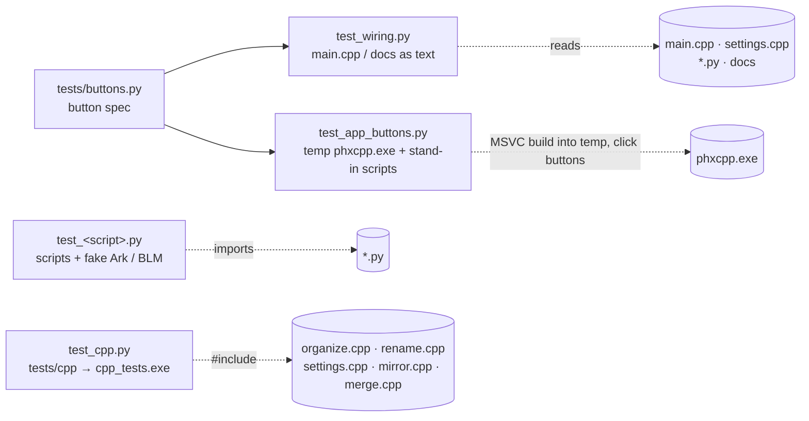

`tests/conftest.py` blocks the browser, network (connections and DNS) and message boxes, and points
`ark_common` at a fake settings.ini, so no test reaches Ark, Enverus, BLM or Slack or touches real files. The C++ builds go to temp
folders, never the repo.
